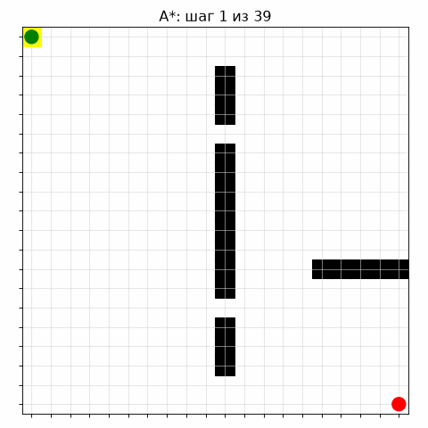
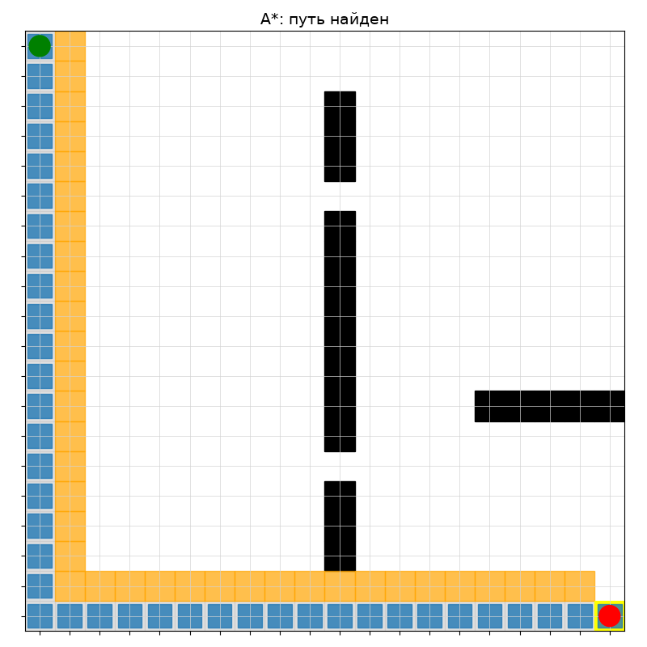

# Учебный проект: визуализация алгоритма A*

**Pet-project** по алгоритмам поиска пути на графах. Демонстрация работы алгоритма A* на сетке с препятствиями.

## Стек
- Python 3.12
- NumPy
- Matplotlib
- ImageIO (для сборки GIF)

## Как работает A*
Алгоритм A* ищет кратчайший путь из точки A в точку B, используя:
- **g(n)** — стоимость пути от старта до узла n;
- **h(n)** — эвристика (манхэттенское расстояние до цели);
- **f(n) = g(n) + h(n)** — приоритет в очереди с приоритетом.

На каждом шаге алгоритм:
1. Достаёт из очереди узел с минимальным `f(n)`.
2. Переносит его в закрытый список (посещённые).
3. Обновляет оценки `g`, `h`, `f` для соседей и кладёт их в открытый список.
4. Останавливается, когда цель извлечена из очереди.

## Результат
Анимация поиска пути (жёлтый — текущий узел, оранжевые — открытый список, серые — закрытый, синий — найденный путь):



Финальный путь:



## Запуск
```bash
python3 -m venv venv
source venv/bin/activate
pip install -r requirements.txt
python3 visualize.py
